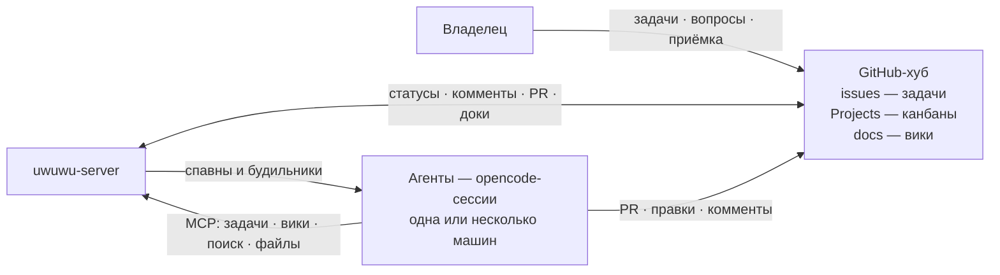

# uwuwu-agent

uwuwu — личный контур разработки, в котором софт ведут ИИ-агенты, а человек ставит задачи и принимает результат. Ядро контура — uwuwu-server: сервер на Rust, который ведёт каждую задачу от заявки до смерженного PR. Репозиторий содержит исходники сервера и конфигурацию агентской платформы opencode — методички агентов, скиллы, плагины, команды.

## Зачем

Кодинг-агенты сильны в точечной работе, но их работа заканчивается на одном диффе. Реальная задача длиннее: уточнение постановки, план, ревью, реализация, тесты, приёмка. Знания, наработанные в сессиях, умирают вместе с сессиями. Рутину приходится выполнять руками. Координация пачки агентов ложится на человека.

uwuwu переносит эту работу на конвейер: задачи живут на канбан-доске и ведутся агентами по стадиям, наработанный опыт оседает в вики, рутина уходит в расписания и ботов.

## Как это устроено

Источник истины — GitHub: issues служат задачами, Projects — канбанами, markdown-доки — вики. Контур приватный: всё живёт в приватных репозиториях, доступ закрыт гейтами.

uwuwu-server следит за досками и комментами. На каждое движение он будит нужного агента в opencode-сессии: аналитика — на новую заявку, разработчика — на задачу в работе, ревьювера — на готовый план или PR, тестировщика — на пройденное ревью. Агент стартует не с нуля: сервер кладёт в сессию персона владельца и доки проекта. Замечания ревью возвращают задачу на доработку, автомерж-демон мержит PR после ревью и тестов, финальную приёмку делает владелец.

Владелец включён точечно: заводит задачу, отвечает агентам в тредах, принимает готовую работу.

## Ядро: uwuwu-server

Rust-монолит с делением на крейты domain → usecase → server.

- **Конвейер задач** — слежение за досками, спавны и будильники агентов по стадиям, автомерж PR, кап параллельных сессий с приоритетами и пик-окнами.
- **MCP API** — агенты работают с контуром через инструменты `uwuwu_*`: задачи, канбаны, вики, поиск, файлы. Один интерфейс, bearer-гейт.
- **Вики поверх GitHub** — доки читаются и пишутся агентами через MCP; вики и задачи живут в одном репозитории-хабе.
- **Поиск** — полнотекст по докам, поиск по заголовкам и семантика на эмбеддингах. Внешний маршрут эмбеддингов недоступен — фолбэк на локальную модель. Отказ секции — явная ошибка, а не тихая пустота.
- **Кроны** — расписание и инструкция живут в markdown-доке; сервер сам спавнит запуск, ведёт журнал ранов и сигнализирует о тишине рана.
- **Телеграм-боты** — бот описывается markdown-доком: поведение, модель, имя переменной с токеном. Сервер держит вечную сессию бота, доставляет сообщения и принимает медиа от владельца.
- **Дример** — разбирает завершённые сессии и пополняет вики: статьи опыта, архитектурные решения, правки доков. Без ручных очередей и заявок.
- **Эксплуатация** — машины-исполнители за релеем с маршрутизацией проектов, сигнализация о сбоях конвейера в Telegram.

## Состав репозитория

- `server/` — uwuwu-server: исходники сервера
- `agents/` — методички агентов конвейера: аналитик, разработчик, ревьюверы, тестировщик, дример
- `skills/` — скиллы opencode: инженерные, правила качества, офисные форматы, интеграции
- `plugins/` — плагины opencode
- `commands/` — слэш-команды opencode
- `lib/` — общий TypeScript-код плагинов и тесты
- `opencodereview/` — правила машинного ревью
- `AGENTS.md` — инструкции агентам
- `opencode.json`, `cli.json` — конфиги opencode
- `link.sh` — привязка конфигов машины к репозиторию симлинками
- `Dockerfile` — relay-сервис для дополнительных исполнителей

## Стек

Rust (axum, tokio) · TypeScript · opencode · GitHub API · Railway

## Лицензия

MIT
