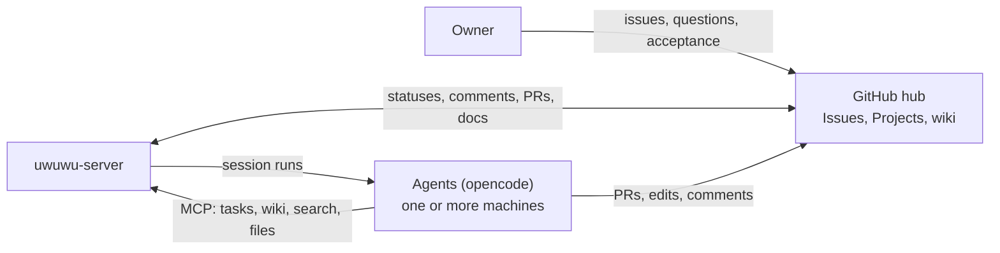

# uwuwu-agent

A personal development setup built on opencode and GitHub. AI agents handle tasks from initial spec to merged PR, while the owner files issues, answers questions, and signs off on finished work.

The repository contains two parts: `uwuwu-server`, a Rust server that drives the workflow, and the opencode configuration (agent prompts, skills, plugins, and commands).

## Why

A coding agent handles a single diff well, but real tasks require clarifying requirements, planning, reviews, testing, and acceptance. Doing all of that manually across separate chats loses context between sessions and turns coordinating agents into a chore.

`uwuwu` ties these steps together on top of GitHub: tasks move across a Kanban board, notes from completed sessions go into a wiki, and recurring work runs on a schedule or through Telegram bots.

## How it works

All state lives in a private GitHub repository (the hub): Issues track tasks, GitHub Projects act as Kanban boards, and markdown files hold documentation and notes.

`uwuwu-server` watches the boards and incoming comments. When a task changes stage, the server starts the corresponding opencode agent:

- analyst for a new issue
- developer for a task in progress
- reviewers for a finished plan, code, or tests
- tester once review passes

Each new session starts with the owner's context and project docs already loaded. Review feedback sends the task back for rework. After review and tests pass, the PR merges automatically, leaving final acceptance to the owner.

## Server (`uwuwu-server`)

Written in Rust and split into three crates: `domain`, `usecase`, and `server`.

* **Task pipeline.** Watches Kanban boards, starts and wakes agents as stages change, auto-merges verified PRs, and caps concurrent sessions based on priorities and peak-hour schedules.
* **MCP API.** Exposes `uwuwu_*` tools behind bearer-token auth so agents can manage issues, boards, wiki pages, search, and files through one interface.
* **GitHub wiki.** Stores docs alongside tasks in the same hub repository; agents read and update them via MCP.
* **Search.** Supports full-text search, heading search, and semantic search with embeddings. Embeddings run on a local model over a tunnel with no external API calls, and a failing search backend returns an explicit error.
* **Scheduled jobs.** Schedules and prompts live in markdown files. The server triggers cron runs, logs executions, and alerts if a run stalls or produces no output.
* **Telegram bots.** Each bot's behavior, model, and token environment variable are defined in a markdown file. The server keeps a persistent bot session running, forwards messages, and accepts media from the owner.
* **Dreamer (`dreamer`).** Reviews finished sessions and writes useful findings back to the wiki: doc updates, architecture decisions, and lessons learned.
* **Operations.** Connects remote worker machines over a relay tunnel with per-project routing and sends pipeline failure alerts to Telegram.

## Repository layout

* `server/` — `uwuwu-server` source code
* `agents/` — agent prompts (analyst, developer, reviewers, tester, dreamer) and the task template
* `skills/` — opencode skills (languages, quality rules, document formats, external tools)
* `plugins/` — opencode plugins
* `commands/` — opencode slash commands
* `lib/` — shared TypeScript code for plugins and tests
* `opencodereview/` — automated code review rules
* `AGENTS.md` — general instructions for agents
* `opencode.json`, `cli.json` — opencode configuration
* `link.sh` — symlinks local machine configs to this repository
* `Dockerfile` — `rathole` relay image for tunnels to worker machines and the local embedding model

## Stack

Rust (axum, tokio), TypeScript, opencode, GitHub API, Railway.

## License

MIT
